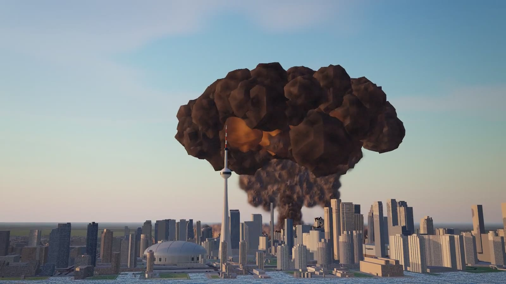

# God's Plan

The sandbox simulator for urban planners and arsonists. Toronto, rebuilt from open data, with physics-based disasters
to throw at it: a nuclear strike, a tsunami out of Lake Ontario and a meteor. Everything runs client-side in WebGL;
there is no backend.



## Run it

```bash
npm install
npm run dev        # http://127.0.0.1:5280  (landing at /, the game at /play)
npm run build      # typecheck + production build into dist/
npm run preview    # serve dist/ on http://127.0.0.1:5281
```

Controls: drag to orbit, right-drag (or Shift-drag) to pan, scroll to zoom toward the cursor, WASD to move, Q/E to
turn. Pick a power (1 nuke, 2 tsunami, 3 meteor) and click the city; R rebuilds, T toggles slow motion, Esc disarms.

## How it works

- `scripts/prepare_toronto.py` (`npm run data`) compiles `public/data/toronto.json` from the original God's Plan city
  pack (OpenStreetMap buildings and surfaces, the City of Toronto's 3D Massing, the lake, roads and landmarks).
- `src/engine/` is the simulator: one merged building mesh whose vertex shader crumbles, tilts and chars buildings from
  a per-building state texture; GPU particles and debris with motion computed in the shader; the disasters as
  choreographed scripts (`fx/disasters.ts`); a camera rig; synthesized sound.
- `src/landing/` is the landing page; `src/play/` the globe and the in-game interface.
- `scripts/record.py` records landing footage frame by frame from the running app (see its docstring);
  `scripts/encode.sh` encodes it into `public/media/`.

## Credits

Map data © OpenStreetMap contributors (ODbL). 3D Massing © City of Toronto, Open Government Licence – Toronto. Earth
imagery: NASA Blue Marble and Black Marble (public domain). Geist (OFL). Started at Hack the North 2026.
